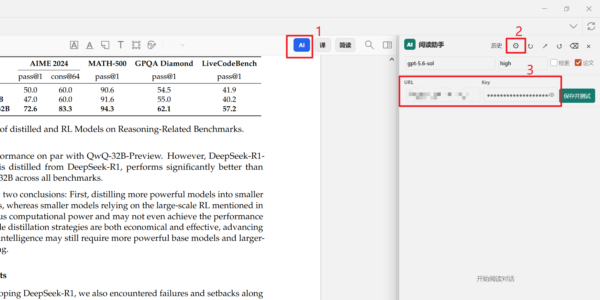
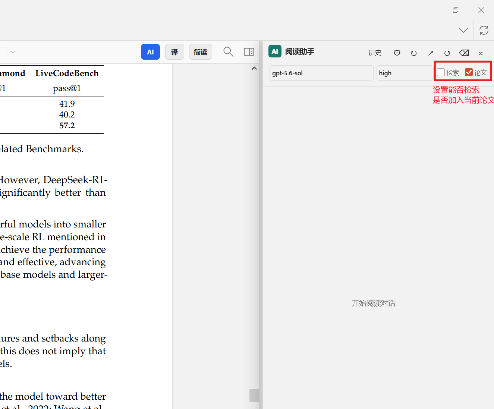
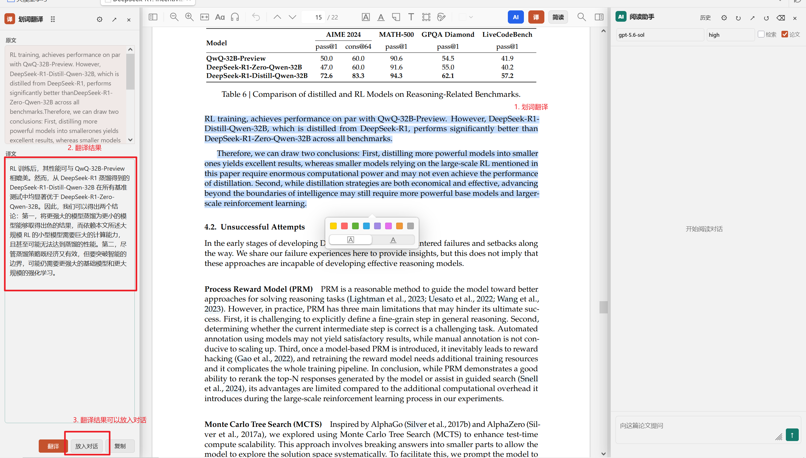
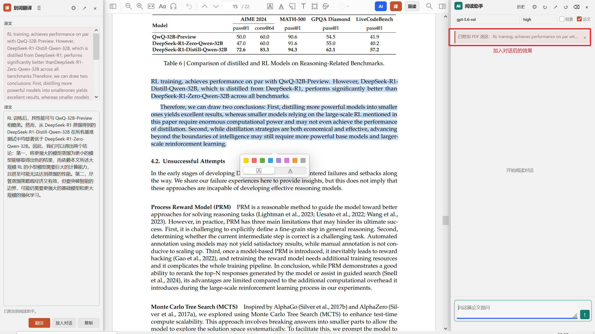
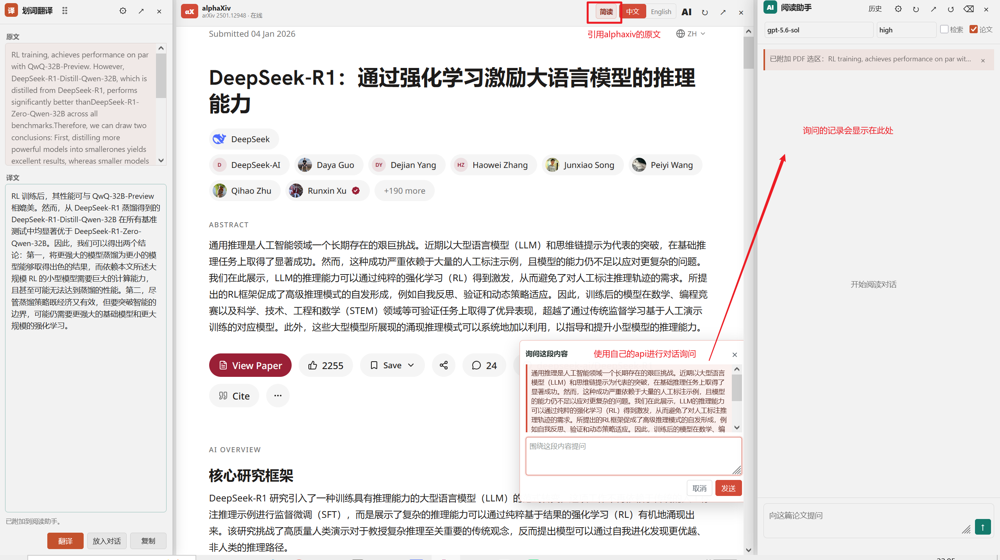

# Zotero AI Reading Studio

一个独立维护的 Zotero 论文阅读工作台。它把 Zotero 的文献、PDF、在线简读和本地 AI 会话放在同一个阅读流程里，面向需要长期积累论文上下文的研究工作。

> 当前仓库是独立重构后的项目版本，使用自己的插件标识、更新源和发布流程。

[English](README.en.md) · [项目主页](https://github.com/Shanfu2021/zotero-ai-reading-studio)

[更新记录](CHANGELOG.md) · [贡献指南](CONTRIBUTING.md) · [安全说明](SECURITY.md)

## 功能

### 本地 Responses AI 对话

- 在 Zotero PDF 阅读器中打开固定的 AI 面板，支持流式输出、思考摘要、Markdown、代码块、表格和引用链接。
- 使用 OpenAI Responses 兼容接口，可配置自定义 API URL、Key、模型和 reasoning effort。
- 阅读模型与翻译模型相互独立；阅读默认使用 `gpt-5.6-sol`，翻译可以单独选择轻量模型和 `low`/`medium`/`high`/`xhigh`/`max`。
- 支持 Responses 的 `previous_response_id` 连续对话；网关不支持连续响应时自动退回 Zotero 本地会话上下文。
- 可开启 `web_search` 检索。模型会区分论文证据、选区上下文和外部检索结果。

### 按论文保存会话

- 会话按论文分别保存为 Zotero 条目下的子笔记。
- 发送第一条消息后才创建会话；历史列表显示每个独立会话的第一条问题作为标题。
- 可以新建会话、切换旧会话、删除单个会话；删除论文或 PDF 时同步清理其会话记录。
- 第一条消息可以显式附加当前 PDF；后续消息复用会话状态或本地检索，不重复上传文件。

### 选区翻译

- 在 PDF 中选择文本后，在固定的翻译面板中显示结果；默认停靠在左侧，让论文和 AI 对话保持居中。
- 支持长选区分段翻译，保留完整顺序，避免只翻译选区的一部分。
- 翻译面板有独立的模型、reasoning 和设置入口，也可以把选中文本加入当前论文会话。

### 在线论文简读

- 识别 Zotero 条目的 arXiv 编号后，可以在阅读器中打开中文或英文的在线简读页面。
- 保留网页中的图片、公式和作者整理的内容；本地 PDF 与在线简读可以互相切换。
- 简读中释放选区后，会在选区附近自动出现本地提问编辑器，不需要再点击网页的 Assistant。
- 简读选区问题会自动带入当前论文会话，并携带章节、段落及前后文。
- AlphaXiv 原生 Assistant/Reply 入口被隐藏，提问统一走本项目配置的 Responses API。

### 面板与阅读体验

- AI、翻译和简读面板可以固定在阅读器内，也可以脱离 Zotero 成为独立窗口。
- 面板支持拖拽停靠；翻译默认左侧，AI 默认最右侧。
- 打开或关闭面板时保留 PDF 的阅读位置；流式回答期间不会强制滚动阅读页面。
- AI 输出失败或连接超时时会保留明确的错误消息，不会留下空的“正在生成”气泡。

## 使用截图

下面的截图来自当前项目版本，覆盖从设置到论文阅读、翻译和简读提问的完整流程。截图中的 API URL 和 Key 已打码；真实凭据只应保存在本机 Zotero 设置中。

### 1. 分离阅读与翻译模型

在 `编辑 -> 设置 -> AI Reading Assistant` 中，阅读模型和翻译模型可以分别配置。阅读默认使用 `gpt-5.6-sol`，翻译可以选择更轻量的模型和独立 reasoning effort。



### 2. PDF 阅读与检索

阅读面板固定在右侧，可以选择阅读模型、官方 reasoning effort，按需开启检索或附加当前 PDF。



### 3. 选区翻译并加入会话

翻译面板默认停靠左侧，显示原文和译文。点击“放入对话”即可把当前选区及译文加入这篇论文的当前会话。





### 4. 在线简读中的选区提问

简读保留网页中的图片、公式和作者整理内容。释放选区后，提问编辑器会在选区附近出现，并通过本项目配置的 Responses API 进入论文会话。



历史会话按论文分别保存；发送第一条消息后才会出现在右侧 AI 面板的历史列表中，列表只显示每个会话的第一句话，点击后可恢复完整对话。截图清单和更新规范见 [`docs/screenshots/README.md`](docs/screenshots/README.md)。

## 安装

1. 从 [Releases](https://github.com/Shanfu2021/zotero-ai-reading-studio/releases) 下载最新的 `.xpi`。
2. 在 Zotero 中打开 `工具 -> 附加组件`，点击齿轮菜单，选择“从文件安装附加组件”。
3. 安装后在 `编辑 -> 设置 -> AI Reading Assistant` 中填写 API URL 和 Key。
4. 在 PDF 阅读器工具栏打开 `AI`、`译` 或 `简读`。

当前版本也可以直接下载：[zotero-ai-reading-0.7.11.xpi](https://github.com/Shanfu2021/zotero-ai-reading-studio/releases/download/v0.7.11/zotero-ai-reading-0.7.11.xpi)。

## 配置

插件使用 OpenAI Responses 兼容接口。API URL 可以填写服务根地址或带 `/v1` 的地址，插件会规范化到 `/v1/responses` 和 `/v1/models`。

常用配置项：

| 配置 | 作用 |
| --- | --- |
| API URL / API key | 连接你自己的兼容服务；只保存在本机 Zotero 偏好设置 |
| Reading model | AI 阅读模型，默认 `gpt-5.6-sol` |
| Reading reasoning | 阅读模型的官方 effort：`low`、`medium`、`high`、`xhigh`、`max` |
| Translation model | 选区翻译模型，与阅读模型分开 |
| Translation reasoning | 翻译专用 reasoning effort |
| PDF attachment | 下一条消息附加当前 PDF，一次会话只附加一次 |
| Web search | 允许 Responses 使用网页检索补充资料 |

不要把真实 Key 写入 `prefs.js`、README、截图、测试文件或 GitHub Actions。仓库只包含空白默认值；详见 [SECURITY.md](SECURITY.md)。

## 从源码构建

要求：Zotero 7+、PowerShell（Windows）或 Bash（macOS/Linux）、Node.js 18+。

Windows：

```powershell
powershell -ExecutionPolicy Bypass -File scripts/build-xpi.ps1
powershell -ExecutionPolicy Bypass -File scripts/test.ps1
```

macOS/Linux：

```bash
bash scripts/build-xpi.sh
node --check zotero-ai-reading.js
```

构建产物位于 `dist/`。`dist/`、`.xpi`、本地诊断结果和常见凭据文件默认被 `.gitignore` 排除，发布时作为 GitHub Release 附件上传。

## 项目结构

```text
bootstrap.js             Zotero 启动入口
zotero-ai-reading.js     阅读器面板、Responses、检索、会话和翻译逻辑
preferences.xhtml        Zotero 设置页
prefs.js                 空白默认偏好值
floating-window.xhtml    可脱离阅读器的面板窗口
scripts/build-xpi.*      XPI 构建脚本
scripts/verify-*.js      无网络合约测试
.github/workflows/       GitHub Actions 校验
```

## 隐私与安全

API Key 和 API URL 存在本机 Zotero 偏好设置中，不会写入仓库。PDF 只有在你明确开启 PDF 附件或本地检索时才发送到配置的服务；开启网页检索后，查询词和必要上下文可能发送给外部检索服务。使用前请确认服务商的数据保留和隐私政策。

如果 Key 曾经进入日志、截图或 Git 提交，应立即在服务商处撤销并重新生成，再清理公开历史。

## 开发检查

提交前至少运行：

```text
node --check zotero-ai-reading.js
node scripts/verify-alphaxiv-panel.js
node scripts/verify-reader-chat.js
node scripts/verify-conversation-sessions.js
node scripts/verify-selection-translation.js
node scripts/verify-detachable-panels.js
node scripts/verify-reader-pane-upload.js
```

## 许可证

MIT License，见 [LICENSE](LICENSE)。
